# OpenGameArt: 3D art

**74 assets from [OpenGameArt](https://opengameart.org), dedicated to the public domain under [CC0](https://creativecommons.org/publicdomain/zero/1.0/).** Use them in any game, free or paid, and change them however you like; no credit is needed.

3D art from OpenGameArt entries licensed CC0 (some also offer other licences; CC0 is the one that applies here). 1.0 GB in all.

This is a copy kept by [zuujis-cc0](https://github.com/zuujis-cc0) so game makers can take single files from GitHub. It is not made by or affiliated with OpenGameArt: the originals, often in more formats and higher resolutions, are on [opengameart.org](https://opengameart.org). If they help you, consider [supporting OpenGameArt](https://opengameart.org/content/faq).

Every file is listed in [MANIFEST.tsv](MANIFEST.tsv) with its size and SHA-256. More free assets: [the Zuujis collection](https://github.com/zuujis-cc0/free-game-assets#readme).

| | | | |
| :-: | :-: | :-: | :-: |
| <a href="free-3d-models-by-sharetextures">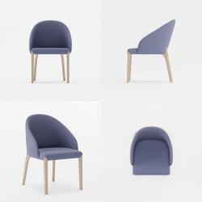</a> <b><a href="free-3d-models-by-sharetextures">Free 3D Models by ShareTextures</a></b> by ShareTextures · <a href="https://opengameart.org/content/free-3d-models-by-sharetextures">source</a> | <a href="free-low-poly-3d-race-car-model-%F0%9F%8F%8D%EF%B8%8F%F0%9F%8F%81%F0%9F%9A%A6%F0%9F%8F%86">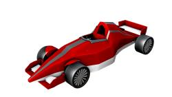</a> <b><a href="free-low-poly-3d-race-car-model-%F0%9F%8F%8D%EF%B8%8F%F0%9F%8F%81%F0%9F%9A%A6%F0%9F%8F%86">Free, Low Poly 3D Race car model 🏍️🏁🚦🏆</a></b> by mabaci · <a href="https://opengameart.org/content/free-low-poly-3d-race-car-model-%F0%9F%8F%8D%EF%B8%8F%F0%9F%8F%81%F0%9F%9A%A6%F0%9F%8F%86">source</a> | <a href="free-lowpoly-pond-kit">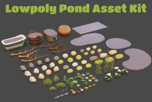</a> <b><a href="free-lowpoly-pond-kit">Free Lowpoly Pond Kit</a></b> by AssetQuest · <a href="https://opengameart.org/content/free-lowpoly-pond-kit">source</a> | <a href="free-scanned-3d-models">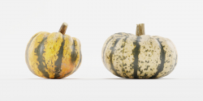</a> <b><a href="free-scanned-3d-models">Free Scanned 3D Models</a></b> by ShareTextures · <a href="https://opengameart.org/content/free-scanned-3d-models">source</a> |
| <a href="fruit-salads">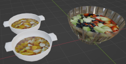</a> <b><a href="fruit-salads">Fruit salads</a></b> by DREAM_SEARCH_REPEAT · <a href="https://opengameart.org/content/fruit-salads">source</a> | <a href="furniture-1">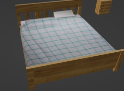</a> <b><a href="furniture-1">Furniture 1</a></b> by DREAM_SEARCH_REPEAT · <a href="https://opengameart.org/content/furniture-1">source</a> | <a href="futuristic-artillery-turret">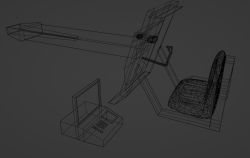</a> <b><a href="futuristic-artillery-turret">Futuristic artillery turret</a></b> by DREAM_SEARCH_REPEAT · <a href="https://opengameart.org/content/futuristic-artillery-turret">source</a> | <a href="futuristic-weapons">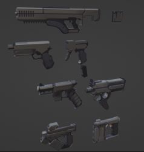</a> <b><a href="futuristic-weapons">Futuristic weapons</a></b> by DREAM_SEARCH_REPEAT · <a href="https://opengameart.org/content/futuristic-weapons">source</a> |
| <a href="gaucho-drinking-mate">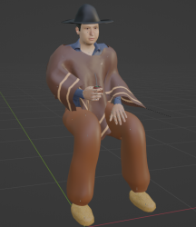</a> <b><a href="gaucho-drinking-mate">Gaucho drinking mate</a></b> by DREAM_SEARCH_REPEAT · <a href="https://opengameart.org/content/gaucho-drinking-mate">source</a> | <a href="gaucho-playing-guitar">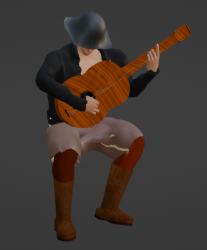</a> <b><a href="gaucho-playing-guitar">Gaucho playing guitar</a></b> by DREAM_SEARCH_REPEAT · <a href="https://opengameart.org/content/gaucho-playing-guitar">source</a> | <a href="glowing-column">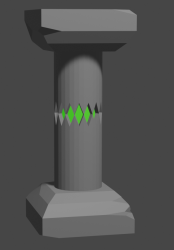</a> <b><a href="glowing-column">Glowing Column</a></b> by LordYeahNah · <a href="https://opengameart.org/content/glowing-column">source</a> | <a href="golgotha-building-3d-version">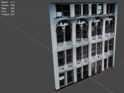</a> <b><a href="golgotha-building-3d-version">Golgotha building 3D version</a></b> by DREAM_SEARCH_REPEAT · <a href="https://opengameart.org/content/golgotha-building-3d-version">source</a> |
| <a href="grape-arbor">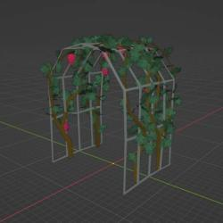</a> <b><a href="grape-arbor">Grape Arbor</a></b> by Mish7913 · <a href="https://opengameart.org/content/grape-arbor">source</a> | <a href="graveyard-0">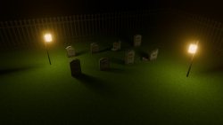</a> <b><a href="graveyard-0">graveyard</a></b> by humble squirrel · <a href="https://opengameart.org/content/graveyard-0">source</a> | <a href="habitable-house">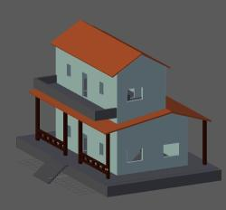</a> <b><a href="habitable-house">Habitable House</a></b> by byzmod3d · <a href="https://opengameart.org/content/habitable-house">source</a> | <a href="hay-bale-0">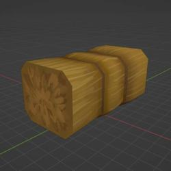</a> <b><a href="hay-bale-0">Hay Bale</a></b> by Mish7913 · <a href="https://opengameart.org/content/hay-bale-0">source</a> |
| <a href="healthy-junk-food-asset-pack">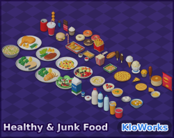</a> <b><a href="healthy-junk-food-asset-pack">Healthy & Junk Food Asset Pack</a></b> by KloWorks · <a href="https://opengameart.org/content/healthy-junk-food-asset-pack">source</a> | <a href="homemade-pizza">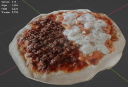</a> <b><a href="homemade-pizza">Homemade Pizza</a></b> by DREAM_SEARCH_REPEAT · <a href="https://opengameart.org/content/homemade-pizza">source</a> | <a href="hospital-medical-center-from-moscow">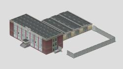</a> <b><a href="hospital-medical-center-from-moscow">Hospital (Medical Center) from Moscow</a></b> by Mixazzz · <a href="https://opengameart.org/content/hospital-medical-center-from-moscow">source</a> | <a href="house-exterior-kit">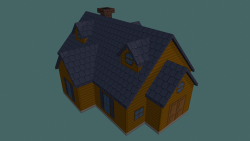</a> <b><a href="house-exterior-kit">House Exterior Kit</a></b> by humble squirrel · <a href="https://opengameart.org/content/house-exterior-kit">source</a> |
| <a href="human-0">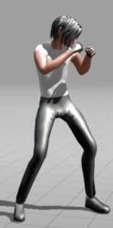</a> <b><a href="human-0">human</a></b> by byzmod3d · <a href="https://opengameart.org/content/human-0">source</a> | <a href="human-and-furry-base-meshes-daemonbase">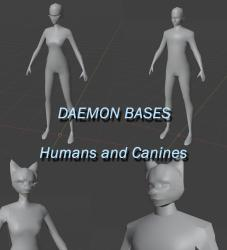</a> <b><a href="human-and-furry-base-meshes-daemonbase">Human and Furry Base Meshes - DaemonBase</a></b> by DaemonOutcast · <a href="https://opengameart.org/content/human-and-furry-base-meshes-daemonbase">source</a> | <a href="human-low-poly-female-girl">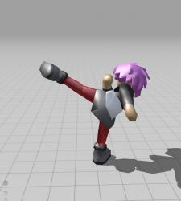</a> <b><a href="human-low-poly-female-girl">HUMAN LOW POLY FEMALE GIRL</a></b> by byzmod3d · <a href="https://opengameart.org/content/human-low-poly-female-girl">source</a> | <a href="inflatables">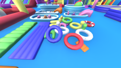</a> <b><a href="inflatables">inflatables</a></b> by loafbrr_1 · <a href="https://opengameart.org/content/inflatables">source</a> |
| <a href="jar-with-sauce">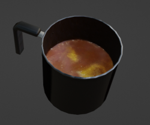</a> <b><a href="jar-with-sauce">Jar with sauce.</a></b> by DREAM_SEARCH_REPEAT · <a href="https://opengameart.org/content/jar-with-sauce">source</a> | <a href="katar">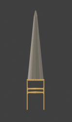</a> <b><a href="katar">katar</a></b> by tbbk · <a href="https://opengameart.org/content/katar">source</a> | <a href="l-shaped-couch">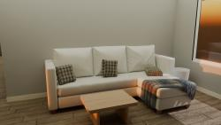</a> <b><a href="l-shaped-couch">L-Shaped Couch</a></b> by beng100 · <a href="https://opengameart.org/content/l-shaped-couch">source</a> | <a href="lightning-pump-action-rifle">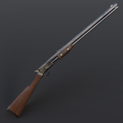</a> <b><a href="lightning-pump-action-rifle">Lightning Pump Action Rifle</a></b> by LonesomeDucky · <a href="https://opengameart.org/content/lightning-pump-action-rifle">source</a> |
| <a href="lily-pads">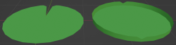</a> <b><a href="lily-pads">Lily Pads</a></b> by Starry Skydancer · <a href="https://opengameart.org/content/lily-pads">source</a> | <a href="little-sweet-pack">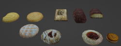</a> <b><a href="little-sweet-pack">Little sweet pack.</a></b> by DREAM_SEARCH_REPEAT · <a href="https://opengameart.org/content/little-sweet-pack">source</a> | <a href="low-poly-3d-pigeon-model-rigged-animated-untextured">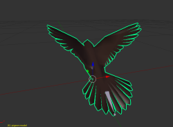</a> <b><a href="low-poly-3d-pigeon-model-rigged-animated-untextured">Low poly 3D Pigeon model (rigged + animated) [untextured]</a></b> by mujtaba-io · <a href="https://opengameart.org/content/low-poly-3d-pigeon-model-rigged-animated-untextured">source</a> | <a href="low-poly-arms-rigged">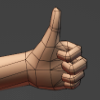</a> <b><a href="low-poly-arms-rigged">Low Poly Arms (Rigged)</a></b> by DevMops · <a href="https://opengameart.org/content/low-poly-arms-rigged">source</a> |
| <a href="low-poly-barrel-1">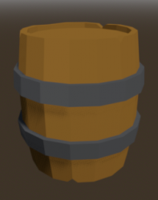</a> <b><a href="low-poly-barrel-1">Low Poly Barrel</a></b> by xTerryx · <a href="https://opengameart.org/content/low-poly-barrel-1">source</a> | <a href="low-poly-biplane-airplane-model">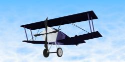</a> <b><a href="low-poly-biplane-airplane-model">Low poly biplane airplane model</a></b> by mujtaba-io · <a href="https://opengameart.org/content/low-poly-biplane-airplane-model">source</a> | <a href="low-poly-bucket">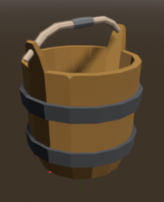</a> <b><a href="low-poly-bucket">Low Poly Bucket</a></b> by xTerryx · <a href="https://opengameart.org/content/low-poly-bucket">source</a> | <a href="low-poly-canon">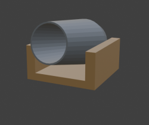</a> <b><a href="low-poly-canon">low poly canon</a></b> by tbbk · <a href="https://opengameart.org/content/low-poly-canon">source</a> |
| <a href="low-poly-chuveiro-brazilian-electric-shower">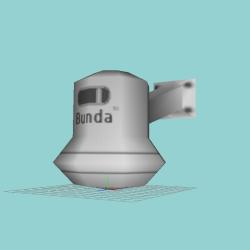</a> <b><a href="low-poly-chuveiro-brazilian-electric-shower">Low Poly Chuveiro (Brazilian Electric Shower)</a></b> by cosmac · <a href="https://opengameart.org/content/low-poly-chuveiro-brazilian-electric-shower">source</a> | <a href="low-poly-coconut-tree">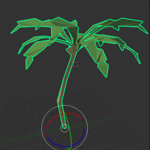</a> <b><a href="low-poly-coconut-tree">low poly coconut tree</a></b> by mujtaba-io · <a href="https://opengameart.org/content/low-poly-coconut-tree">source</a> | <a href="low-poly-cow">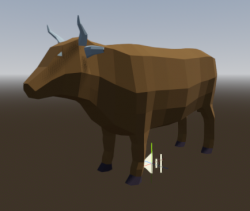</a> <b><a href="low-poly-cow">Low Poly Cow</a></b> by xTerryx · <a href="https://opengameart.org/content/low-poly-cow">source</a> | <a href="low-poly-deer">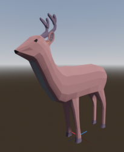</a> <b><a href="low-poly-deer">Low Poly Deer</a></b> by xTerryx · <a href="https://opengameart.org/content/low-poly-deer">source</a> |
| <a href="low-poly-dice-0">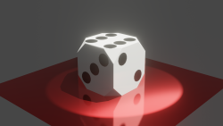</a> <b><a href="low-poly-dice-0">Low-Poly Dice</a></b> by Tianmaru · <a href="https://opengameart.org/content/low-poly-dice-0">source</a> | <a href="low-poly-fantasy-rpg-models">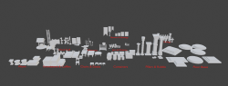</a> <b><a href="low-poly-fantasy-rpg-models">Low Poly Fantasy RPG Models</a></b> by IsmeWesley · <a href="https://opengameart.org/content/low-poly-fantasy-rpg-models">source</a> | <a href="low-poly-fokker-triplane">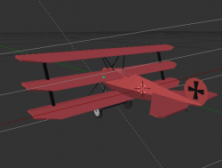</a> <b><a href="low-poly-fokker-triplane">low poly fokker triplane</a></b> by mujtaba-io · <a href="https://opengameart.org/content/low-poly-fokker-triplane">source</a> | <a href="low-poly-halloween-kit">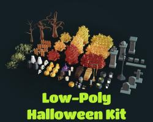</a> <b><a href="low-poly-halloween-kit">Low-Poly Halloween Kit</a></b> by AssetQuest · <a href="https://opengameart.org/content/low-poly-halloween-kit">source</a> |
|  <b><a href="low-poly-mushroom-kit">Low Poly Mushroom Kit</a></b> by AssetQuest · <a href="https://opengameart.org/content/low-poly-mushroom-kit">source</a> | <a href="low-poly-papaya">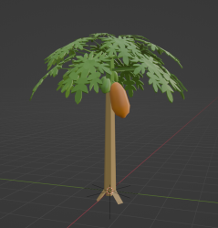</a> <b><a href="low-poly-papaya">Low Poly Papaya</a></b> by JellyLion · <a href="https://opengameart.org/content/low-poly-papaya">source</a> | <a href="low-poly-pig-0">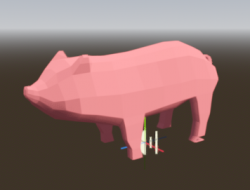</a> <b><a href="low-poly-pig-0">Low Poly Pig</a></b> by xTerryx · <a href="https://opengameart.org/content/low-poly-pig-0">source</a> | <a href="low-poly-psx-style-medieval-soldier-rigged-animated">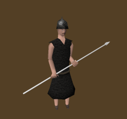</a> <b><a href="low-poly-psx-style-medieval-soldier-rigged-animated">low-poly PSX Style Medieval Soldier [Rigged + Animated]</a></b> by mujtaba-io · <a href="https://opengameart.org/content/low-poly-psx-style-medieval-soldier-rigged-animated">source</a> |
| <a href="low-poly-simple-roulette-wheel">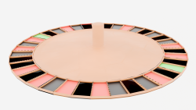</a> <b><a href="low-poly-simple-roulette-wheel">Low Poly Simple Roulette Wheel</a></b> by oceancucumber · <a href="https://opengameart.org/content/low-poly-simple-roulette-wheel">source</a> | <a href="low-poly-spaceship-0">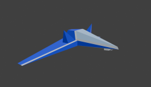</a> <b><a href="low-poly-spaceship-0">low poly spaceship</a></b> by tbbk · <a href="https://opengameart.org/content/low-poly-spaceship-0">source</a> | <a href="low-poly-speaker">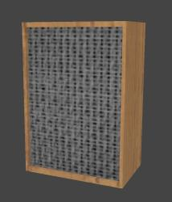</a> <b><a href="low-poly-speaker">Low Poly Speaker</a></b> by cosmac · <a href="https://opengameart.org/content/low-poly-speaker">source</a> |  <b><a href="low-poly-sword-3d-model">Low poly Sword 3D model</a></b> by mujtaba-io · <a href="https://opengameart.org/content/low-poly-sword-3d-model">source</a> |
|  <b><a href="low-poly-toothbrushes">Low Poly Toothbrushes</a></b> by Hoplite Game Dev · <a href="https://opengameart.org/content/low-poly-toothbrushes">source</a> |  <b><a href="low-poly-warrior-model-made-as-parts-no-skeleton">Low poly warrior model made as parts (no skeleton)</a></b> by TheNess · <a href="https://opengameart.org/content/low-poly-warrior-model-made-as-parts-no-skeleton">source</a> |  <b><a href="low-poly-well">Low poly Well</a></b> by xTerryx · <a href="https://opengameart.org/content/low-poly-well">source</a> |  <b><a href="low-poly-woman">Low Poly Woman</a></b> by byzmod3d · <a href="https://opengameart.org/content/low-poly-woman">source</a> |
|  <b><a href="low-quality-flashlight">Low Quality Flashlight</a></b> by neincenets · <a href="https://opengameart.org/content/low-quality-flashlight">source</a> |  <b><a href="low-spec-burger-demon">Low Spec Burger Demon</a></b> by pistachio · <a href="https://opengameart.org/content/low-spec-burger-demon">source</a> |  <b><a href="low-spec-pirates-cutlass">Low Spec Pirate's Cutlass</a></b> by pistachio · <a href="https://opengameart.org/content/low-spec-pirates-cutlass">source</a> |  <b><a href="low-spec-toon-pirate-chest">Low Spec Toon Pirate Chest</a></b> by pistachio · <a href="https://opengameart.org/content/low-spec-toon-pirate-chest">source</a> |
|  <b><a href="lowpoly-dummy-character10-animations">Lowpoly Dummy Character(10 Animations)</a></b> by Umplix · <a href="https://opengameart.org/content/lowpoly-dummy-character10-animations">source</a> |  <b><a href="lowpoly-male">Lowpoly Male</a></b> by NotionHD · <a href="https://opengameart.org/content/lowpoly-male">source</a> |  <b><a href="lowpoly-pixelart-vehicle">Lowpoly pixelart vehicle.</a></b> by glebster51 · <a href="https://opengameart.org/content/lowpoly-pixelart-vehicle">source</a> |  <b><a href="make-up">Make up</a></b> by DREAM_SEARCH_REPEAT · <a href="https://opengameart.org/content/make-up">source</a> |
|  <b><a href="mast-blender-425">Mast (Blender 4.2.5)</a></b> by Djsedj · <a href="https://opengameart.org/content/mast-blender-425">source</a> |  <b><a href="medications-pack-1-flatboxes">Medications pack 1 flatboxes.</a></b> by DREAM_SEARCH_REPEAT · <a href="https://opengameart.org/content/medications-pack-1-flatboxes">source</a> |  <b><a href="medications-pack-2-syrup-boxes">Medications pack 2 Syrup boxes</a></b> by DREAM_SEARCH_REPEAT · <a href="https://opengameart.org/content/medications-pack-2-syrup-boxes">source</a> |  <b><a href="medieval-3d-drain">Medieval 3D drain</a></b> by ShggothSlave · <a href="https://opengameart.org/content/medieval-3d-drain">source</a> |
|  <b><a href="medieval-chair-pbr">Medieval Chair PBR</a></b> by Unseeliefae · <a href="https://opengameart.org/content/medieval-chair-pbr">source</a> |  <b><a href="medieval-chair-pbr-0">Medieval Chair PBR</a></b> by Unseeliefae · <a href="https://opengameart.org/content/medieval-chair-pbr-0">source</a> |  <b><a href="medieval-theme-voxels-asset-pack">Medieval Theme Voxels Asset Pack</a></b> by FuzzyManStudios · <a href="https://opengameart.org/content/medieval-theme-voxels-asset-pack">source</a> |  <b><a href="mines-and-cave-set">mines and cave set</a></b> by loafbrr_1 · <a href="https://opengameart.org/content/mines-and-cave-set">source</a> |
|  <b><a href="mk2-grenade">Mk2 Grenade</a></b> by LonesomeDucky · <a href="https://opengameart.org/content/mk2-grenade">source</a> |  <b><a href="modern-studio-camera">Modern studio camera</a></b> by DREAM_SEARCH_REPEAT · <a href="https://opengameart.org/content/modern-studio-camera">source</a> |  |  |

---

Kept up to date by this repository's own [update workflow](.github/workflows/update.yml), with code and plan from [cc0-mirror](https://github.com/zuujis-cc0/cc0-mirror). Something wrong? [Open an issue there](https://github.com/zuujis-cc0/cc0-mirror/issues/new) or use the [private report form](https://games.zuujis.com/report).
